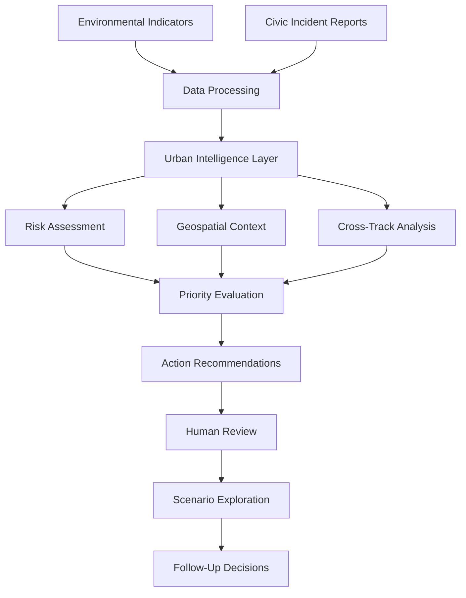
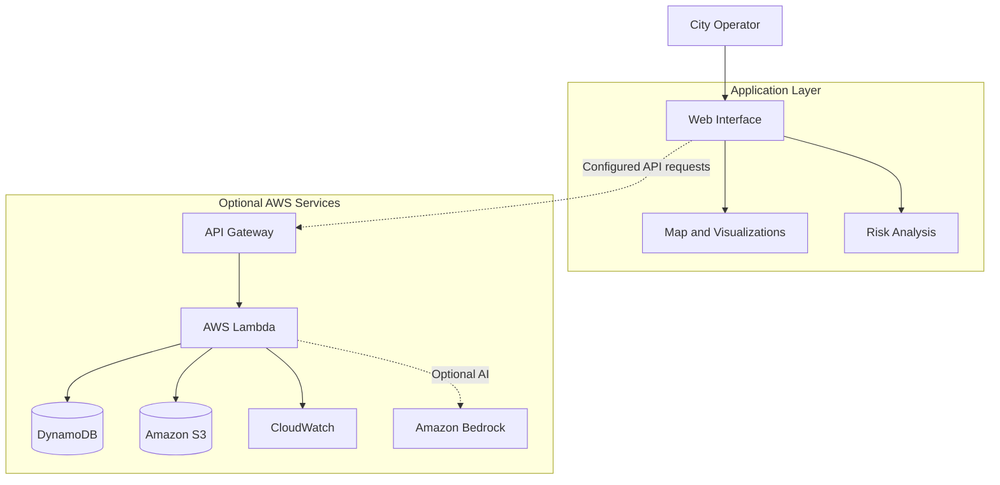

<div align="center">


### 🌍 Rethinking the Future of Urban Living

**Observe the city. Understand the risks. Prioritize the action.**

CitySutra AI is an AI-powered urban climate intelligence platform designed to connect environmental signals, civic incidents, and actionable insights to support smarter and more resilient cities.

<br/>

<a href="https://citysutra.vercel.app/">

</a>
<a href="https://github.com/amanchakervarti7-dot/citysutra-ai">

</a>

<br/><br/>


</div>

---

## 🏙️ 01. The Vision

Cities are living systems. Every neighborhood generates signals about its environment, infrastructure, resources, and people.

Air-quality changes, extreme temperatures, waterlogging, and waste-related incidents can interact in ways that are difficult to understand through disconnected systems.

**CitySutra AI aims to transform these fragmented signals into a unified urban intelligence experience.**

The platform brings together environmental context, geospatial exploration, risk prioritization, and scenario-based planning to help users better understand urban challenges.

Our vision is to make city intelligence more accessible, transparent, and actionable.

## 🎯 02. The Problem We Are Solving

Urban challenges are interconnected, but the information used to understand them is often fragmented.

| Challenge | Urban impact |
|---|---|
| 🌫️ Air pollution | Environmental exposure and reduced urban livability |
| 🌡️ Extreme heat | Increased heat exposure and pressure on city resources |
| 💧 Water challenges | Waterlogging, rainfall-related disruption, and water stress |
| ♻️ Waste mismanagement | Waste accumulation and potential environmental hazards |
| ⚡ Resource inefficiency | Difficulties prioritizing and coordinating interventions |

The real challenge is not simply collecting more data.

It is answering five important questions:

- What is happening?
- Where is the problem occurring?
- Which risks deserve attention first?
- Why has a particular issue been prioritized?
- What intervention could help improve the situation?

CitySutra AI is designed around these questions.

## 💡 03. The CitySutra Approach

CitySutra AI connects urban information through a decision-support workflow.

| Stage | Purpose |
|---|---|
| Observe | Explore available environmental indicators and civic reports |
| Understand | Examine geographic context and contributing factors |
| Evaluate | Assess risk using configured scoring methods |
| Prioritize | Organize incidents and potential interventions |
| Explore | Compare hypothetical environmental scenarios |
| Review | Keep operational decisions under human supervision |

The objective is to move from isolated observations toward **context-aware, explainable, and evidence-informed urban decisions.**

## ✨ 04. Core Capabilities

### 🌫️ Environmental Intelligence

Bring environmental indicators and sustainability concerns into a unified experience.

- Air-quality information
- Heat-related risk indicators
- Water and rainfall concerns
- Waste-management incidents
- Energy and sustainability indicators

The availability of individual indicators depends on the configured data sources.

### 🗺️ Geospatial Intelligence

Explore the geographic context behind reported urban problems.

- Interactive map visualization
- Location-based incident exploration
- Geographic context for available risk indicators
- Spatial understanding of reported concerns

### 🧠 Explainable Risk Engine

Understand how the platform prioritizes potential urban risks.

- Configurable scoring weights
- Indicator-based risk assessment
- Cross-track interaction rules
- Contributing-factor explanations
- Visibility into missing information and assumptions

Risk scores are indicators for decision support, not guarantees of actual harm or precise predictions.

### 🚨 Civic Incident Management

Support structured handling of urban incidents.

- Review and filter available reports
- Inspect incident details and locations
- Track supported workflow states
- Record decisions where configured
- Maintain a clearer view of reported concerns

### 🎯 Intelligent Action Prioritization

Help users organize potential interventions according to available evidence.

- Prioritized action queues
- Risk-related context
- Suggested intervention categories
- Reviewable recommendations
- Opportunities for follow-up

### 🌱 Environmental Scenario Exploration

Experiment with hypothetical improvements through adjustable assumptions.

Possible scenarios include:

- Waste collection efficiency
- Water-management alternatives
- Waste diversion strategies
- Energy-related improvements
- Resource utilization scenarios

Scenario outputs are estimates. They should not be interpreted as measured or guaranteed environmental outcomes.

---

## 🔄 05. How It Works



The workflow connects available observations with risk assessment and potential interventions.

Recommendations are intended to support human judgment rather than independently authorize real-world civic action.

## 🏗️ 06. Technical Architecture

The application can be understood as a web-based urban intelligence interface with optional cloud-backed services.



### Architecture components

| Component | Role |
|---|---|
| Next.js | Web application framework |
| React | UI components |
| TypeScript | Typed application logic |
| Tailwind CSS | Interface styling |
| Recharts | Data visualization |
| Leaflet | Interactive mapping |
| PostgreSQL | Relational data storage, where configured |
| Drizzle ORM | Database access, where configured |
| AWS Lambda | Serverless application logic |
| Amazon API Gateway | API access |
| Amazon DynamoDB | NoSQL data storage |
| Amazon S3 | Object and evidence storage |
| Amazon CloudWatch | Logging and monitoring |
| Amazon Bedrock | Optional generative AI capabilities |

**Implementation note:** The architecture above describes the intended or optional system design. Confirm the repository's dependencies, backend integrations, and AWS configuration before treating every component as deployed functionality.

## 🧰 07. Technology Stack

<div align="center">


</div>

| Layer | Technology |
|---|---|
| Frontend | Next.js, React, TypeScript |
| Styling | Tailwind CSS |
| Visualization | Recharts |
| Mapping | Leaflet, OpenStreetMap |
| Validation | Zod |
| Data access | Drizzle ORM |
| Database | PostgreSQL, where configured |
| Cloud backend | AWS Lambda, API Gateway |
| Storage | DynamoDB, Amazon S3 |
| Monitoring | Amazon CloudWatch |
| Optional AI | Amazon Bedrock |
| Testing | Vitest |
| Deployment | Vercel and optional AWS infrastructure |

## 🚀 08. Getting Started

### Prerequisites

- Node.js
- npm
- Git
- Required environment variables and service credentials, if applicable

### Step 1 — Clone the repository

```bash
git clone https://github.com/amanchakervarti7-dot/citysutra-ai.git
```

### Step 2 — Navigate to the project

```bash
cd citysutra-ai
```

If the application resides in a nested directory, navigate to the directory containing its `package.json`.

### Step 3 — Install dependencies

```bash
npm install
```

### Step 4 — Configure the environment

Check the repository for `.env.example` or equivalent configuration documentation.

If an example file exists:

```bash
cp .env.example .env
```

Configure only the variables required by your selected application mode. Keep API keys, passwords, and cloud credentials private.

### Step 5 — Start the development server

```bash
npm run dev
```

Open the local URL printed in the terminal. The port depends on the framework and project configuration.

> These instructions assume a Node.js application. Verify the repository structure, package scripts, and required services before running the commands.

## 🌐 09. Explore the Live Application

Experience CitySutra AI through the deployed website.

<div align="center">

<a href="https://citysutra.vercel.app/">

</a>

<br/><br/>

**Live Demo:** [citysutra.vercel.app](https://citysutra.vercel.app/)

**Source Code:** [github.com/amanchakervarti7-dot/citysutra-ai](https://github.com/amanchakervarti7-dot/citysutra-ai)

</div>

## 🌆 10. Example Use Case

### Connecting a waste incident with environmental context

Imagine a city operator receives a report about open waste burning while elevated air-quality indicators are available for the surrounding area.

A potential CitySutra workflow could help the operator:

1. Review the available air-quality information.
2. Locate the reported incident.
3. Examine the risk assessment and its contributing factors.
4. Review the suggested response and underlying assumptions.
5. Record an operational decision through the supported workflow.

The same approach can be explored for waterlogging and rainfall-related signals or heat concerns and water-access incidents.

This example illustrates a possible decision-support workflow. It does not imply automatic hazard verification or guaranteed municipal response.

## 🔐 11. Responsible AI and Transparency

Urban decision-support systems must communicate uncertainty and respect human accountability.

CitySutra AI emphasizes:

- **Transparent inputs:** identify data sources and assumptions.
- **Explainable priorities:** make scoring logic understandable.
- **Data quality:** acknowledge incomplete or outdated observations.
- **Human oversight:** review recommendations before operational action.
- **Privacy:** protect sensitive information and access credentials.
- **Honest impact estimates:** distinguish hypothetical scenarios from measured outcomes.

The platform is not a substitute for official environmental monitoring, emergency response systems, or authorized municipal decisions.

## 🛣️ 12. Future Roadmap

Potential future improvements include:

- Integration with verified environmental monitoring networks
- More localized climate-risk analysis
- Better data-quality validation
- Improved geospatial analytics
- Authenticated municipal workspaces
- Role-based access and audit trails
- More robust incident assignment workflows
- Locally validated environmental impact models
- Expanded cloud deployment automation
- Evaluation of AI-generated explanations

These are potential development directions, not a claim that all capabilities are already available.

## 🤝 13. Contributing

Contributions, suggestions, and improvements are welcome.

1. Fork the repository.
2. Create a feature branch.
3. Implement your changes.
4. Test the changes locally.
5. Commit with a descriptive message.
6. Submit a pull request.

Example:

```bash
git checkout -b feature/your-feature
git add .
git commit -m "feat: improve urban intelligence"
git push origin feature/your-feature
```

## 🔗 14. Project Links

| Resource | Link |
|---|---|
| 🌐 Live Application | [CitySutra AI](https://citysutra.vercel.app/) |
| 💻 GitHub Repository | [citysutra-ai](https://github.com/amanchakervarti7-dot/citysutra-ai) |

---

<div align="center">


### 🌱 A Better City Begins With Better Intelligence.

**CitySutra AI — Connecting urban challenges with smarter decisions.**

<sub>Built around the vision of climate resilience, sustainable development, and intelligent cities.</sub>

<br/>

[Live Demo](https://citysutra.vercel.app/) · [GitHub](https://github.com/amanchakervarti7-dot/citysutra-ai)

</div>

