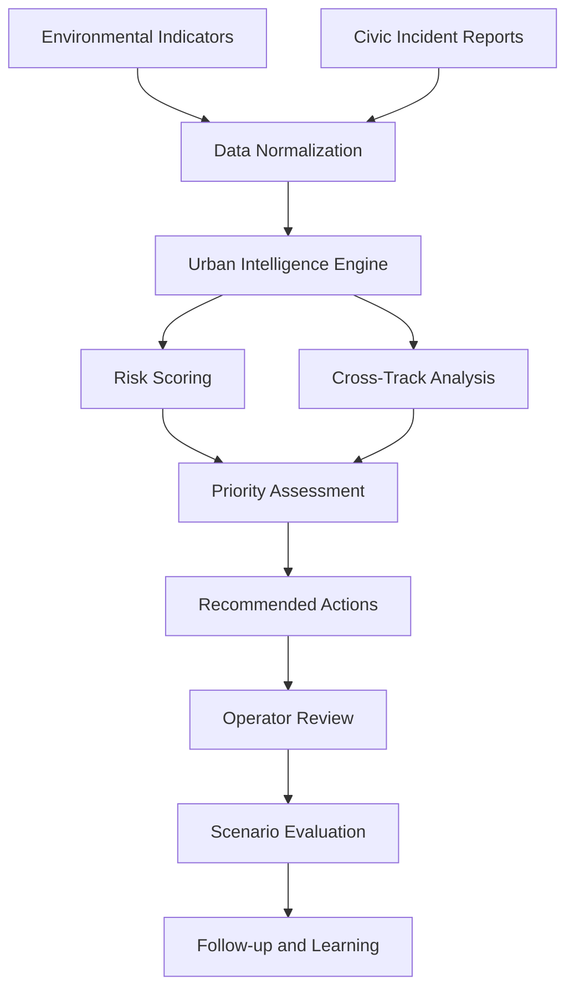
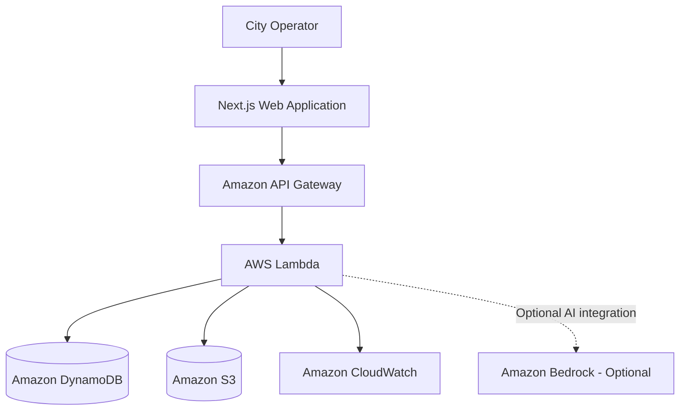

# 🌐 CitySutra AI
### Urban Intelligence. Climate Resilience. Actionable Impact.

<div align="center">


<br/>

**Cities generate signals. CitySutra turns them into decisions.**

An AI-powered Urban Climate Intelligence platform designed to connect environmental risks, civic incidents, and intervention planning in one unified experience.

<br/>

<a href="https://citysutra.vercel.app/">

</a>
<a href="https://github.com/Ansh-vibe/citysutra-ai">

</a>

<br/><br/>


</div>

---

## 🌍 The Big Idea

Cities do not experience environmental challenges in isolation.

A rise in temperature can increase water demand. Heavy rainfall can create waterlogging. Improper waste disposal can contribute to local environmental problems. Air pollution can make an already vulnerable neighborhood even more difficult to live in.

Yet environmental observations, civic complaints, and operational decisions are often handled through disconnected workflows.

**CitySutra AI is designed to connect these signals into a shared urban intelligence experience.**

Instead of simply presenting information, the platform aims to help operators understand the context, examine potential risks, prioritize incidents, and explore possible interventions.

> From fragmented city signals to explainable decisions — one urban intelligence layer.

## ⚠️ The Challenge

| Urban challenge | Why it matters |
|---|---|
| 🌫️ Air pollution | Poor air quality can threaten public health and urban livability. |
| 🌡️ Extreme heat | Heat exposure can increase risks for vulnerable communities. |
| 💧 Water stress | Flooding, waterlogging, and shortages require timely attention. |
| ♻️ Waste mismanagement | Accumulated waste and open burning can create environmental concerns. |
| ⚡ Resource inefficiency | Poor coordination can limit the effectiveness of urban interventions. |

The central challenge is not just collecting data. It is understanding which signals matter, why they matter, and what action deserves attention first.

## 💡 What CitySutra AI Does

CitySutra AI brings together five essential stages of urban decision support:

1. **Observe** — Review available environmental indicators and civic incidents.
2. **Connect** — Examine geographic context and relationships between urban challenges.
3. **Evaluate** — Calculate interpretable risk and priority scores from available inputs.
4. **Recommend** — Organize potential interventions into an actionable workflow.
5. **Learn** — Explore scenarios and use their assumptions to support better planning.

The result is a platform concept focused on proactive, evidence-informed urban management.

## ✨ Platform Capabilities

### 📡 01 — Environmental Intelligence

Bring multiple climate and sustainability dimensions into one interface.

- Air-quality indicators
- Heat-related risk signals
- Water and rainfall concerns
- Waste-management incidents
- Energy and sustainability indicators

The availability and accuracy of each indicator depend on the configured data sources.

### 🗺️ 02 — Geospatial Risk Exploration

Understand the geographic context behind environmental concerns.

- Interactive city-map experience
- Location-based civic incident exploration
- Geographic context for reported problems
- Visual inspection of available risk information

### 🧠 03 — Explainable Risk Analysis

Make risk prioritization easier to understand.

- Configurable scoring weights
- Multiple environmental indicators
- Cross-track interaction rules
- Contributing-factor explanations
- Visibility into assumptions and missing inputs

Risk scores are decision-support indicators, not definitive predictions of real-world harm.

### 🚨 04 — Civic Incident Workflow

Structure the process of handling reported urban problems.

- Review available civic reports
- Filter incidents by relevant attributes
- Inspect incident locations and context
- Update supported workflow states
- Record operational decisions where configured

### 🎯 05 — Action Prioritization

Help operators focus their attention on potentially important problems.

- Prioritized action queue
- Supporting risk factors
- Suggested intervention categories
- Reviewable operator decisions
- Follow-up workflow opportunities

### 🌱 06 — Environmental Scenario Studio

Explore hypothetical interventions through editable assumptions.

Examples include:

- Changes in waste collection efficiency
- Alternative water-management scenarios
- Waste diversion and resource utilization
- Illustrative energy-related improvements

Scenario outputs are estimates based on their inputs and assumptions. They should not be interpreted as verified environmental outcomes.

---

## 🔄 System Workflow



**Design principle:** recommendations should remain explainable, reviewable, and subject to human judgment.

## 🏗️ Architecture

CitySutra AI combines a web application with an optional serverless backend architecture.



### Architecture Components

| Component | Responsibility |
|---|---|
| Next.js | Web application and page rendering |
| React | Component-based user interface |
| TypeScript | Typed application development |
| Amazon API Gateway | HTTP API entry point |
| AWS Lambda | Serverless backend execution |
| Amazon DynamoDB | Structured application records |
| Amazon S3 | Supported file and evidence storage |
| Amazon CloudWatch | Logging and monitoring |
| Amazon Bedrock | Optional generative AI integration |

AWS components require the relevant deployment, permissions, environment variables, and service configuration. The diagram describes the optional architecture, not proof that every service is connected to the live demo.

## 🧰 Technology Stack

<div align="center">


</div>

| Category | Technology |
|---|---|
| Frontend | Next.js, React, TypeScript |
| Styling | Tailwind CSS |
| Charts | Recharts |
| Maps | Leaflet, OpenStreetMap |
| Validation | Zod |
| Database access | Drizzle ORM, PostgreSQL |
| Serverless backend | AWS Lambda, API Gateway |
| Storage | Amazon DynamoDB, Amazon S3 |
| Observability | Amazon CloudWatch |
| Optional generative AI | Amazon Bedrock |
| Testing | Vitest |
| Deployment | Vercel and optional AWS infrastructure |

Refer to the repository configuration to confirm which dependencies and integrations are active in the current version.

## 🚀 Run CitySutra AI Locally

### Prerequisites

- Node.js and npm
- Git
- A compatible development environment
- Database credentials or API keys, if required by your selected configuration

### 1. Clone the repository

```bash
git clone https://github.com/Ansh-vibe/citysutra-ai.git
```

### 2. Enter the application directory

```bash
cd citysutra-ai/citysutra-ai-platform-development
```

### 3. Install dependencies

```bash
npm install
```

### 4. Configure environment variables

Check the project documentation and example environment files before configuring credentials.

```bash
cp .env.example .env
```

If the repository does not contain `.env.example`, create the required configuration according to the application's existing setup. Never commit private API keys, database passwords, or AWS credentials.

### 5. Start the development server

```bash
npm run dev
```

Open the local URL shown in the terminal. The default may be `http://localhost:3000`, depending on the project configuration.

**Important:** The directory path and commands above should be checked against the current repository structure, `package.json`, and environment configuration.

## 🌆 Example Scenario

### When a waste incident meets an air-quality concern

Imagine an operator receives a civic report about open waste burning while local air-quality indicators are elevated.

A CitySutra AI workflow could help the operator:

1. Inspect the available air-quality information.
2. Locate the reported incident on the map.
3. Review its assigned priority and contributing factors.
4. Examine the available recommendation and its assumptions.
5. Record a decision and track the incident through its configured workflow.

A comparable approach could be used to examine rainfall signals alongside waterlogging reports or heat indicators alongside water-access concerns.

These examples illustrate intended decision-support workflows. They do not establish that the platform independently detects every hazard or verifies that a proposed intervention has succeeded.

## 🔐 Responsible AI and Data Transparency

Trust is essential when technology supports decisions about cities and communities.

CitySutra AI emphasizes the following principles:

- **Data transparency:** distinguish live observations, third-party estimates, and demonstration data.
- **Explainability:** document the inputs and assumptions behind risk scores.
- **Uncertainty awareness:** identify missing, incomplete, or potentially outdated information.
- **Human oversight:** require appropriate review before real-world interventions.
- **Privacy awareness:** protect sensitive incident information and credentials.
- **Honest impact reporting:** distinguish scenario estimates from measured outcomes.

CitySutra AI is a decision-support platform, not a replacement for validated environmental monitoring, emergency services, or authorized municipal decision-making.

## 🛣️ Future Roadmap

Potential opportunities for further development include:

- Integration with verified environmental sensor networks.
- Localized forecasting with measured model performance.
- Improved geospatial risk analysis.
- Secure municipal workspaces and role-based access.
- Automated data-quality checks and monitoring.
- Incident assignment, escalation, and audit trails.
- Locally validated environmental impact calculations.
- Expanded AWS deployment automation.
- Evaluation of AI-generated explanations for reliability.

## 🤝 Contributing

Contributions and constructive feedback are welcome.

1. Fork the repository.
2. Create a feature branch.
3. Make your changes.
4. Test the implementation.
5. Commit with a descriptive message.
6. Open a pull request.

```bash
git checkout -b feature/your-feature
git add .
git commit -m "feat: describe your improvement"
git push origin feature/your-feature
```

## 🔗 Project Links

<div align="center">

| Resource | Link |
|---|---|
| 🌐 Live Demo | [citysutra.vercel.app](https://citysutra.vercel.app/) |
| 💻 Source Code | [Ansh-vibe/citysutra-ai](https://github.com/Ansh-vibe/citysutra-ai) |

</div>

---

<div align="center">


### 🌍 Better Insights. Smarter Actions. Stronger Cities.

**CitySutra AI — Making urban complexity easier to understand and act upon.**

<sub>Exploring the intersection of artificial intelligence, climate resilience, and sustainable urban development.</sub>

<br/>

<a href="https://citysutra.vercel.app/">Live Demo</a> · <a href="https://github.com/Ansh-vibe/citysutra-ai">GitHub</a>

</div>

